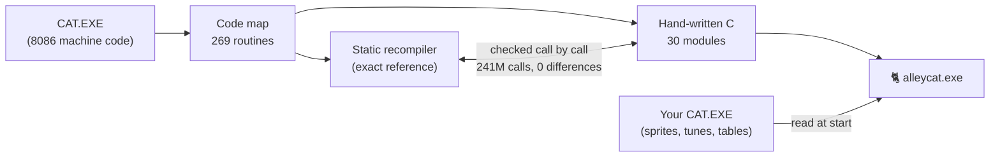

  

  <b>Bill Williams' 1984 IBM PC classic <i>Alley Cat</i>, rewritten in C for Windows and macOS.</b> 
  No DOSBox, no game files included &mdash; bring your own <code>CAT.EXE</code> and play.

  
  
  
  
  

<!-- Screenshots are not included on purpose: they would be the original game's artwork. -->

> [!IMPORTANT]
> **This project contains no game data.** You need your own copy of the original DOS program
> **`CAT.EXE`** (55,067 bytes, dated 22 August 1984). Please only use a copy you are legally
> entitled to use. Don't ask for the game file here.

---

## ✨ Highlights

- 🐈 **The real game, natively**: every routine of the original 8086 program was rewritten by hand
  in C and compiled to native code (x86-64 on Windows, ARM64 on Apple Silicon). There's no DOSBox.
- ✅ **Checked against the original**: the handwritten routines are compared register for register
  and byte for byte with a machine-exact recompilation. Upstream reports **241 million calls, zero
  differences**; this Mac port passed **40,937,961 comparisons, zero mismatches** in its 41-job suite.
  See [coverage and validation limits](docs/MACOS_VALIDATION.md).
- 🔒 **Ships nothing copyrighted**: the download contains only this project's own code. Your
  `CAT.EXE` supplies the sprites, tunes and tables when the game starts, and is only ever read.
- ⏱️ **Original speed and feel**: timing follows a 4.77 MHz IBM PC with CGA graphics, including the
  18.2 Hz timer and the vertical retrace the game paces itself on.
- 🔊 **PC-speaker sound** synthesised from the emulated 8253 timer, exactly as the game drives it.
- 🕹️ **Keyboard and gamepad**: a modern controller works as the old PC joystick. You also get a
  resizable 4:3 window, full screen and screenshots.

## 🚀 Getting started

### Windows

1. Download the latest release from the [**Releases**](../../releases) page and unzip it anywhere.
2. Start **`alleycat.exe`**.
3. Select your **`CAT.EXE`** when asked. The game checks it's the right file and remembers where it
   is in `alleycat.ini`.

You can also put `CAT.EXE` next to `alleycat.exe`, or start `alleycat.exe C:\path\to\CAT.EXE`.

> [!TIP]
> Windows may show *"Windows protected your PC"* for a newly downloaded program. Click
> **More info → Run anyway**. The game isn't code-signed, which is normal for free hobby projects.

### macOS on this branch

Build `AlleyCat.app` using the [development guide](docs/DEVELOPMENT.md), then open it and choose
your original game file. The file may be named `cat.exe`; its contents must match the known original.
The Mac picker remembers your selection in the application's per-user settings directory.

Settings, screenshots, and logs are stored under the directory returned by SDL's application
preferences API (normally `~/Library/Application Support/AlleyCat/`), outside the app bundle.
Use **Option** for the game's Alt action; the original **Control** shortcuts still apply.
Fullscreen is **Option+Return** or F11, and screenshots use F12 (Fn may be needed on some keyboards).

The Mac build targets macOS 11.0 or newer at compilation; the actual validation environment and
remaining compatibility limits are recorded in [macOS validation](docs/MACOS_VALIDATION.md).
Local artifacts are not a claim of Developer ID signing or notarization; see the artifact manifest.

## 🎮 Controls

| Action | Keyboard | Gamepad |
|---|---|---|
| Move / climb / jump | Arrow keys | D-pad / left stick |
| Special action (lap milk, put down a brick, go through holes) | `Alt` | A |
| Pause ("paws") | `Esc` | Start |
| Sound on / off | `Ctrl`+`S` | |
| Restart the game | `Ctrl`+`R` | |
| Back to the menu | `Ctrl`+`M` | |
| Full screen | `F11` or `Alt`+`Enter` | |
| Screenshot (PNG next to the program on Windows; application screenshots directory on Mac) | `F12` | |

To use the gamepad's analogue stick as the PC joystick, answer **Y** to the game's joystick question.

## 🛠️ How it works

*Alley Cat* is about 25 KB of hand-written 8086 assembly that talks straight to the hardware: CGA
video memory, the 8253 timer and PC speaker, and its own keyboard interrupt handler. The port was
built in two stages:

1. **Recompile**: a static recompiler translated every instruction into C on an exact model of the
   CPU and an IBM PC. That build plays the game perfectly and serves as the reference.
2. **Rewrite**: every routine was then rewritten by hand, and a checker ran both versions from the
   same state on thousands of autoplayed games, comparing registers, flags, memory, port I/O and
   interrupts after every call.

The released program is built from the hand-written C alone. Reference builds generate recompiled
code from your own `CAT.EXE`; release-only builds do not need the game file until runtime. Generated
reference code is never committed. Release packaging includes a filtered byte-match audit against
the original file alongside checks of the packaged contents.

More detail: [rewrite method and status](docs/REWRITE.md) ·
[development guide](docs/DEVELOPMENT.md)

## 🧱 Building from source

You need Python 3.10+, CMake 3.20+, and a C compiler: Apple Clang/Command Line Tools on macOS,
or LLVM-MinGW on Windows. CMake downloads the pinned SDL2 source for GUI builds. See the
[**development guide**](docs/DEVELOPMENT.md) for release-only builds, reference comparisons, and packaging.

## ❓ FAQ

**Where do I get `CAT.EXE`?**
This project can't help with that. Use a copy you're legally entitled to use, for example from your
own original disk.

**It says the file isn't the known `CAT.EXE`.**
Only the original 1984 IBM release (55,067 bytes) is supported. Other versions, or files changed
by a cracker or packer, are refused.

**Is this an emulator?**
No. The game's logic is native C. What remains is a small model of the 1984 hardware the game draws
and plays sound through: CGA video memory, timer and speaker, and keyboard.

**Why does it look so chunky?**
It's 320 × 200 in four colours, just like a CGA screen in 1984. That's the point. 🙂

## 🙏 Credits & licence

- *Alley Cat* &copy; 1983–84 Bill Williams / SynSoft, published by IBM. This is an unofficial,
  non-commercial fan project, not affiliated with or endorsed by the copyright holders.
- [SDL2](https://www.libsdl.org/) (zlib licence) for the window, input and audio.
- CPU core and recompiler tools adapted from [LOHT-Recomp](https://github.com/Syncr0ndi/LOHT-Recomp)
  (MIT).
- Developed with assistance from [Claude](https://claude.com/claude-code) by Anthropic.

This project's own code is released under the [MIT licence](LICENSE) &copy; 2026 Syncr0ndi.
The licence covers only this project's code, not the game itself. Third-party details are in
[THIRD_PARTY_NOTICES.md](THIRD_PARTY_NOTICES.md).
