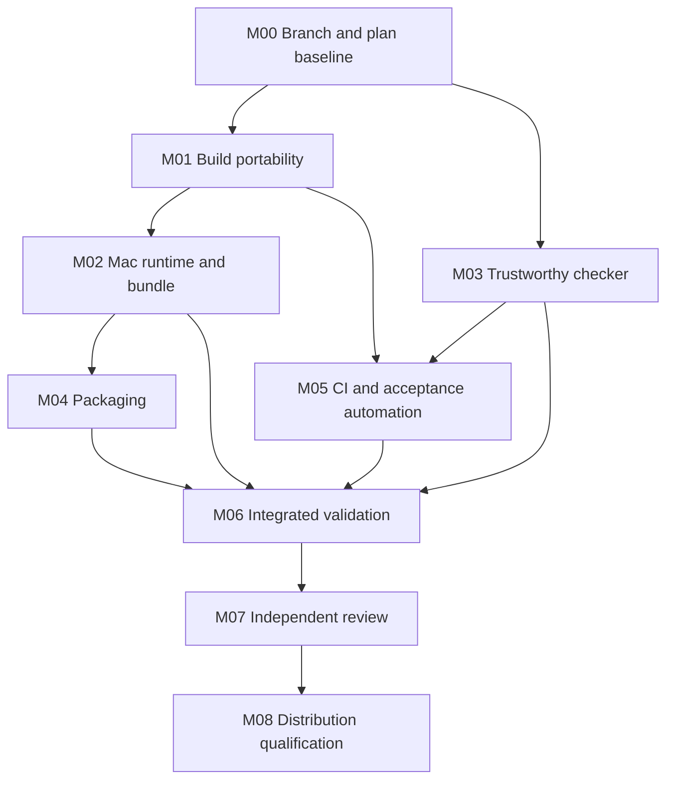

# macOS agent execution plan

Status: prepared for review; implementation has not started.

This plan produces an Apple Silicon macOS application from the existing C game and SDL2 front end. It builds on [the feasibility assessment](MACOS_FEASIBILITY.md), including the successful native launch, user-confirmed graphics and sound, and 40,937,961 comparisons with zero mismatches. The work stays on `macos`; `main` remains an upstream mirror.

The intended first deliverable is a locally validated `.app` and release archive with explicit signing status. A publicly distributable, signed and notarized artifact is a separate completion state. The workflow is designed for agents to implement, test, inspect the UI, review, and integrate without assigning routine implementation or testing tasks to the user.

## Repository baseline and branch policy

On 21 November 2026 these refs pointed to `ed19308f2e73100fbe4fb09dd3585f083ff7361b`:

- `main`
- `origin/main`, the user's fork at `https://github.com/sdangit/AlleyCat-Recomp.git`
- `upstream/main`, the original repository at `https://github.com/Syncr0ndi/AlleyCat-Recomp.git`

The local `macos` branch was created from that revision. `main` tracks `upstream/main`, has `origin` as its push remote, disables pull rebasing, and uses `--ff-only` as its branch merge option. No remote branches were changed. The feasibility assessment and this plan belong to `macos`, not `main`.

The coordinator owns branch operations. Workers must never switch the root checkout's branch, advance `main`, push to any remote, or rewrite shared history. Future synchronization follows this policy:

1. Require a clean coordinator checkout and record current branch/ref SHAs.
2. Fetch `upstream` and `origin`; confirm the remote URLs before using them.
3. Check that local `main` is an ancestor of `upstream/main`. If it has diverged, stop the sync and report the commits; never reset or force-push it.
4. Fast-forward `main` to `upstream/main`, then return to `macos`.
5. Merge `upstream/main` into `macos` at a task boundary. Preserve the long-lived branch history; do not routinely rebase a branch that agents or remotes already share.
6. Reconcile task baselines and rerun affected gates. An upstream change to owned files invalidates an agent's earlier integration assumptions.

Pushing the synchronized fork or macOS branch, creating a PR, uploading artifacts, and publishing a release are separate external actions. They are not part of this planning turn. During execution, the coordinator may prepare these actions but must follow the user's then-current authorization. Never push to `upstream`.

## Scope and fixed decisions

| Decision | Execution contract |
|---|---|
| Initial architecture | Native `arm64`. Keep Intel source compatibility, but universal packaging and physical Intel certification are not initial deliverables. |
| OS baseline | Use macOS 11.0 as the initial compilation deployment target, subject to an SDK compatibility check in M01. This is a build objective, not a claim of testing on macOS 11. Report the actual tested OS separately. |
| Runtime | Preserve the handwritten game, PC model, CPU model, renderer, and timing design. No gameplay refactor or SDL3 migration. |
| SDL dependency | Keep SDL2 2.30.9 and its existing SHA-256 pin. Static SDL linkage; Apple system frameworks remain dynamic. |
| Python | Correct the declared minimum to Python 3.10. Retain the generator's existing newline behavior. |
| Build options | Preserve `CAT_BUILD_APP`; introduce `CAT_BUILD_REFERENCE`, default ON to preserve existing development behavior. Release instructions explicitly set reference OFF. |
| GUI artifact | Bundle only the release GUI target as `AlleyCat.app` on Apple. Keep the development GUI and both headless runners convenient to invoke from a terminal. |
| Identity | Use `io.github.sdangit.alleycat` as this fork's initial bundle identifier. Keep it in one build setting so a future distribution identity can be changed deliberately. |
| Mac file picker | A small Objective-C bridge using `NSOpenPanel`, called from the existing main thread through a C interface. Preserve the Windows picker. |
| Mac storage | Use `SDL_GetPrefPath("sdangit", "AlleyCat")`; settings at its root, PNGs under `screenshots/`, diagnostic reports under `logs/`. Create required directories and check writes. |
| Game data | Preserve exact SHA-256 validation. No download, embedded copy, altered hash, generated reference code, screenshots, or audio in public releases or CI artifacts. |
| Windows behavior | Preserve the existing game picker, executable-relative storage, target names, and packaging command. Shared correctness fixes must be tested and explained. |
| Agent organization | One coordinator, at most three active workers. Separate worktrees and task branches. Only one full comparison suite runs at a time. |

The native picker must accept any filename and case; correctness comes from `game_file_load()`, not a `CAT.EXE` filename filter. The accepted audit file was named `cat.exe`.

Controller hot-plug redesign, Bluetooth qualification, the plain-C rewrite described in `REWRITE.md`, App Store sandboxing, and a broad dependency upgrade are outside this iteration. Record defects discovered in these areas; do not expand scope unless they block the agreed Mac behavior.

## Agent coordination and state

The machine-readable [task ledger](macos/tasks.json) defines dependencies, owners, and initial states. `depends_on` controls when implementation may start; `acceptance_depends_on` lists additional integrated tasks needed before accepting the delivery. `gates_contributed` identifies product checks a task supplies, not checks automatically marked passed when its code is accepted. This plan defines behavior and acceptance. The coordinator updates both together if a contract changes. Workers return findings and commits; they do not edit the central ledger or mark their own task accepted.

At execution start, the coordinator creates ignored `build/macos-agent/` storage for session configuration, evidence, private game-derived files, and per-task handoffs. The existing audit directory is an optional cache, never a required input. Reconfirm the user-provided game file's hash before use. Pass its path through a local `CAT_EXE` variable or ignored session file; do not commit the user's absolute path.

Create each worker's worktree from its recorded integration SHA, under a writable temporary directory, on a branch such as `macos/task-m02-runtime`. All task commands run in that assigned worktree. Use a separate build directory per task/configuration. A resumed agent must first inspect its branch, worktree status, task state, and latest handoff before continuing.

The coordinator integrates one reviewed task commit series at a time, normally by cherry-pick. Do not integrate both an original commit and a cherry-picked copy. If a task has become stale, reconcile its changes against the current integration revision before accepting it. Do not delete a worktree containing uncommitted work or the only copy of evidence.

Tasks touching `CMakeLists.txt` are strictly sequential: M01, then M02, then M04. This is a temporal ownership lock, not permission for concurrent edits. `src/app/main.c` belongs only to M02. M03 owns the headless runner and checker; M05 owns CI and final validation automation. Cross-owner needs become concrete requests to the coordinator, with the proposed interface and reason.

No custom skill is required initially. The bounded task briefs below are sufficient for this port. If execution reveals a repeated workflow that merits a skill, the coordinator may create a narrow task-specific skill without adding new approval requirements or replacing these contracts.

### Worker launch brief

Every dispatched task receives this information explicitly, even if the agent inherits conversation context:

```text
Task: <ID and title>
Goal: <specific output and acceptance gates>
Worktree: <absolute path>; branch: <task branch>; baseline: <SHA>
Read: docs/MACOS_PLAN.md, docs/MACOS_FEASIBILITY.md, your ledger entry
Dependencies: <accepted commits and interface decisions>
Own: <exact paths>; do not modify other owners' files
Inputs: <local toolchain, private session-config path if needed>
Constraints: preserve game semantics, SDL pin, SHA check, Windows behavior
Validate: <focused checks for this task; resource budget>
Return: commits, changed paths, commands/exit codes, evidence, open issues
Do not push, alter main/upstream, publish, or expand scope.
```

Each handoff records task ID, baseline SHA, produced commit SHAs, owned/changed paths, contract changes, commands, exit statuses, evidence paths, and unresolved findings. Distinguish `PASS`, `FAIL`, `BLOCKED`, and `NOT_RUN`. A blocked check needs a concrete reason and must not become a passing check by omission.

The coordinator uses `pending -> running -> review -> accepted`. Failed review returns a task to `running`; a missing external prerequisite can set `blocked`. Acceptance requires evidence against the integrated revision. Record upstream and integration SHAs so work survives agent restarts and context compaction.

## Task graph and execution waves



M00 is preparation completed in this planning turn. After execution is authorized, start M01 and M03 in parallel. Integrate M01 before dispatching M02 and before M03's real-runner smoke. Once M03 is integrated, M05 can run alongside M02 and later M04, but its acceptance waits for M02/M04 integration so the bundle and packaging interfaces can be exercised. M04 starts only after M02 is integrated, releasing its CMake ownership. M06 and M07 use the final integrated implementation. M08 is conditional on credentials and distribution authorization; it does not hold unrelated engineering work open.

### M01 Build portability

Owner: build agent. Paths: `CMakeLists.txt`, `src/pc/pc.h`, and any necessary build-only CMake helpers. Do not modify game implementation or runtime behavior.

Deliverables:

- Include `<stddef.h>` where `size_t` is declared; remove the need for audit-only forced includes.
- Require Python 3.10 with a clear configuration error for older interpreters.
- Separate release compilation from reference generation. Only reference-enabled configurations require and validate `CAT_EXE` or invoke `catrecomp.py`.
- Make `cat_test_release` independent of SDL and `CAT_BUILD_APP`.
- Preserve existing target names and Windows compile/link conditions. Keep SDL fetching inside app-enabled configuration.
- Establish architecture/deployment settings before compiler initialization where required. Apply Mac-specific choices only on the appropriate platform; do not force ARM on non-Mac builds.

Required build matrix:

| Reference | App | Targets | Game required to configure/build |
|---|---|---|---|
| OFF | OFF | `cat_test_release` | No |
| OFF | ON | `cat_test_release`, `alleycat_release` | No |
| ON | OFF | `cat_test_release`, `cat_test` | Yes |
| ON | ON | All four existing executable targets | Yes |

Acceptance: all four configurations compile on the host without `-include stddef.h`; reference OFF produces no reference `gen/` sources; app OFF does not configure/download SDL; missing/wrong game data fails clearly with reference ON. Reproduce the 6,000-frame release hash run after the source header correction. Supply stable build commands for downstream agents.

### M02 Mac runtime and bundle

Owner: runtime agent. Paths: `src/app/main.c`, new `src/app/macos.h` and `src/app/macos.m`, `CMakeLists.txt` after M01, and an initial `cmake/macos/Info.plist.in`. Do not change game/CPU semantics or the test runner.

The platform bridge exposes a small C API with selected, cancelled, and error outcomes. Use caller-owned UTF-8 output and error buffers with explicit capacities; never return a truncated path as success. Keep Objective-C memory ownership inside the bridge. Enable Objective-C and add Cocoa linkage only for Apple app targets. The bridge selects a file; `game_file_load()` remains the sole content validator.

Required behavior:

- Finder first launch opens the picker when no usable saved/discovered file exists. Cancellation exits cleanly; picker failure reports an error; invalid data stays rejected and can be reselected.
- A valid selected path is stored as an absolute UTF-8 path. A missing/moved saved file returns to selection.
- Preserve the existing non-persistent command-line game-path behavior. An invalid explicit path produces a clear diagnostic and nonzero exit, rather than silently changing the saved selection.
- Separate read-only application/resource paths from writable state. Mac writes use the agreed preference directory and subdirectories. Keep Windows paths unchanged.
- Support an absolute `ALLEYCAT_STATE_DIR` diagnostic environment override for isolated agent tests. Validate it, create directories, and report failures. It must not bypass game validation or alter normal behavior when unset.
- Report failed preference and screenshot writes. Crash messages identify the log location only if writing succeeded. `--selftest` returns nonzero if rendering/readback or PNG output fails and reports the actual output path.
- Handle paths with spaces and non-ASCII characters without truncation or shell interpolation. Do not add user game files to the bundle.
- Create `AlleyCat.app` for `alleycat_release`, with stable bundle metadata and high-DPI support. Keep headless/development CLI paths unchanged.

The runtime handoff supplies the exact bundle executable path, preference/output behavior, bridge API, and any flags used by validation. Acceptance includes first launch, cancel, invalid/valid selection, relaunch persistence, missing saved file recovery, explicit-path failure, isolated-state writes, and a real graphical self-test. Use available desktop automation for native dialogs and input. Record an environment block if display automation is unavailable rather than treating a dummy SDL driver as a Finder test.

### M03 Trustworthy checker and test tooling

Owner: verification agent. Paths: `tools/check.py`, `tools/hand_coverage.py`, `src/app/test_main.c`, and focused checker tests under `tests/`. This can start in parallel with M01.

The headless runner must expose a machine-readable `--capabilities` response before loading game data, identifying release/reference comparison capability and a schema version. It must reject unknown hand modes; a release runner must reject `--hand-mode check` explicitly instead of returning a stub zero-mismatch success.

The Python checker must verify that capability, honor subprocess return codes, bound concurrency through `--jobs`, enforce a per-job timeout, and fail on mismatches, missing completion data, malformed results, crashes, or incomplete job sets. Require positive aggregate direct comparisons. Do not require every individual job to compare something; a quit run may end early.

Keep readable console reporting and add a versioned JSON report with executable identity, source revision supplied by the caller, game digest rather than private pathname, exact parameters, per-job results, counts, coverage, duration, and failure reasons. Python tests use small subprocess fixtures to demonstrate that exit failure, timeout, truncated output, false zero reports, malformed capabilities, and wrong runner types cannot pass. These are tests of failure detection, not copies of the implementation.

Preserve `--exe` and support platform-native default executable names. Make the coverage tool accept an explicit runner/build location and resolve LLVM tools through the selected toolchain, including `xcrun` on Mac when appropriate. Do not add a hard requirement for Ninja where another configured generator works.

Acceptance: negative tests pass without `CAT.EXE`; capability query works without game data; the release runner refuses check mode; after M01 integration, a focused real-reference-runner smoke completes with positive comparisons and zero mismatches. Reserve the full 41-job suite for M06/G03. Implementation can start before M01, but acceptance cannot.

### M04 Mac release packaging

Owner: packaging agent. Depends on integrated M02. Paths: new `tools/make_macos_release.py`, `release/macos/`, `cmake/macos/`, and `CMakeLists.txt` after M02. Preserve the Windows packaging script and player guide.

Produce an allowlisted staging tree and ZIP containing only the release `.app`, Mac player instructions, and required licenses. Use a predictable archive name containing version and architecture. Preserve executable permissions and bundle structure. Create a Mac icon from repository-owned artwork if suitable; do not extract art from the game. Keep bundle/icon configuration in the existing build target rather than hand-editing a signed artifact.

Emit an external sidecar manifest with source SHA, architecture, deployment target, SDL version/hash, final archive SHA-256, included paths, and signing state. The sidecar is not inside the archive whose checksum it records. An optional internal manifest must omit that archive checksum. Inspect every bundled Mach-O dependency with `otool`; reject accidental Homebrew or other developer-machine runtime dependencies. Verify plist structure and archive extraction. Require a clean staged tree; never recursively delete an arbitrary caller-provided directory.

Before a release candidate passes its private content audit, validate the known original hash and scan packaged executables against the original using the repository's filtered 32-byte heuristic, including the last possible window. Also enforce the staging allowlist. A no-asset packaging smoke test can validate structure, but it must report the original-byte audit as not run and cannot be labeled a fully audited release. Do not claim the byte heuristic proves provenance.

Prepare optional signing/notarization inputs using existing system identities/keychain profiles; do not embed secrets or create credentials. Distinguish local unsigned/ad-hoc artifacts from distribution artifacts. Any signing must precede final manifest/hash/archive generation, and all final validation must refer to the resulting bytes. Uploading to Apple's notary service belongs to M08, not this task's default packaging path.

Acceptance: archive extracts correctly, dependencies and contents meet the allowlist, no game-derived media or generated reference sources are present, and the extracted app launches using the isolated preference path. Final player docs identify Option/Control keys, fullscreen/screenshots, expected game-file selection, and the actual signing status without claiming untested OS support.

### M05 CI and agent acceptance automation

Owner: automation agent. Depends on M01 and M03. Paths: `.github/workflows/macos.yml`, new `tools/validate_macos.py`, and tests specific to that validator. Do not modify M03's checker or M02's runtime directly.

Public CI builds release-only configurations without `CAT_EXE`, runs capability/negative tests, and inspects the app when the bundle implementation is integrated. Include a Windows release compile check using a compatible toolchain. Verify currently available runner labels and architecture before selecting them; pin third-party actions to reviewed immutable revisions. Do not run workflows on `main` merely because this branch introduces them; scope the port workflow to `macos`, task PRs targeting it, or explicit dispatch as appropriate.

No public job may download the game, run the reference generator with private assets, or upload generated game code, PNGs, WAVs, personal paths, or credentials. Any artifact upload must enumerate allowed paths rather than upload an entire build directory. Unavailable Windows infrastructure is a reported regression-validation gap, never an inferred pass.

The local validator orchestrates available build/CLI/artifact checks and emits a versioned JSON report keyed by gate ID, tested commit, command, status, duration, evidence path, and reason. Keep native UI automation as a coordinator-driven step when the current tool runtime cannot be invoked from a repository script. Do not replace native UI evidence with simulated success.

Acceptance: CI configuration can be reviewed and its local checks exercised without assets; validator failures produce nonzero exit; private checks require explicit input; missing hardware/credentials are represented accurately; no generated artifacts or secrets enter Git. Acceptance also waits for M02/M04 integration and a local exercise of their bundle/packaging interfaces. Remote workflow execution waits for the relevant push/dispatch authorization and access. M05's implementation may be accepted with G08 still unexecuted; that never counts as Windows validation or complete product acceptance.

### M06 Integrated validation and documentation

Owner: coordinator. Depends on M02, M03, M04, and M05. Validate a fresh build from the integrated revision, using no forced headers or audit-only source patches. Reuse a verified dependency cache if desired, but do not reuse stale object files as evidence of a clean build.

Run the gate matrix below; save raw logs privately and an aggregate report. Update `docs/DEVELOPMENT.md`, `README.md`, `THIRD_PARTY_NOTICES.md`, and a new `docs/MACOS_VALIDATION.md` with the implemented behavior and exact limitations. Preserve the feasibility report as historical evidence rather than rewriting its original failures as if they never occurred. Update only relevant Windows documentation where shared prerequisites changed.

The coordinator resolves integration defects through the owning worker, then reruns affected checks. A shared runtime/build change requires the corresponding Windows regression check. A packaging-only change requires artifact checks; it does not automatically justify rerunning millions of game comparisons.

### M07 Independent review

Owner: a fresh review agent that did not implement the reviewed changes. Read-only review of the final diff from upstream, task handoffs, validation reports, bundle/ZIP manifest, and source/release exclusions.

Check ownership boundaries, error paths, memory/path handling, reference/release separation, checker false-success risks, Windows impact, and unsupported compatibility claims. Report findings with file/line, severity, reproduction, and the violated acceptance condition. The coordinator returns findings to their owners and repeats affected gates. Acceptance requires no unresolved release-blocking defect; known environmental gaps remain explicit.

### M08 Distribution qualification

Owner: coordinator/release agent, after M07. Execute only when the user has authorized external distribution actions and an appropriate Developer ID identity/notarization profile is available. Inspect the existing identity/profile without printing secrets; do not create accounts or purchase memberships.

Sign with appropriate hardened-runtime settings, validate signatures, submit for notarization, verify acceptance, staple and validate the ticket, create the final archive, then regenerate its external sidecar checksum manifest and inspect the final artifact. Assess Gatekeeper behavior on the intended artifact where the environment permits it. Never disable Gatekeeper or substitute ad-hoc signing for Developer ID in the report.

If credentials or external authorization are missing, mark distribution qualification blocked with that specific reason and deliver the local artifact with its actual completion state and instructions. Publishing a GitHub release or changing remote branches is not implied by a successful local package or notarization check.

## Validation gates and evidence

| Gate | Required evidence | Completion effect |
|---|---|---|
| G01 Build matrix | Four M01 configurations; correct target inventory; no forced header; no game/reference generation in release-only builds | Engineering requirement |
| G02 Checker integrity | Capability detection, rejection of release check mode, bounded execution, negative fixtures, JSON schema validation | Engineering requirement |
| G03 Reference comparison | 41 default all-room jobs complete, zero mismatches, positive comparisons, actual per-routine direct/nested coverage and exit results | Engineering requirement |
| G04 Deterministic release | Six baseline video hashes for seed 1/6,000 frames/rooms, zero interpreted instructions, valid PNG/WAV and nonzero audio samples | Engineering requirement |
| G05 Mac interaction | Native first launch, cancel, invalid/valid selection, persisted relaunch, missing-file recovery, keyboard input, fullscreen, screenshot, quit | Engineering requirement where desktop automation is available; missing access is an explicit blocked gate |
| G06 Storage and relocation | Isolated preferences, spaces/non-ASCII paths, read-only bundle, relocation, writes outside `.app`, truthful failure reporting | Engineering requirement |
| G07 Package | Allowlist, private byte audit, plist, architecture, dependencies, licenses, archive permissions, extracted-app launch, final manifest hashes | Engineering requirement for the locally audited archive |
| G08 Windows preservation | Release-only compile with supported Windows toolchain; shared Python tests; review of changed shared paths | Required regression evidence; unavailable environment prevents a claim of complete cross-platform validation |
| G09 Independent review | Findings addressed or explicitly classified; validation refers to final integrated commit | Engineering requirement |
| G10 Distribution | Developer ID signature, notarization acceptance, staple validation, final archive checks | Distribution readiness only |

G03's audit baseline is 40,937,961 comparisons: 63 routines directly compared, 184 nested-only, 13 uncounted. Do not hardcode the total as a universal pass condition; compare any change in coverage with the same command/configuration and explain it. The 13 IDs are recorded in the feasibility report. `0000` bypasses direct comparison deliberately; the other gaps remain gaps, not blanket exemptions.

G04 uses these video-memory hashes at frames 1,000 through 6,000: `e594e876`, `6ab7983c`, `a8cd91e7`, `d3d5664c`, `259e94eb`, `04d420cc`. A mismatch requires investigation rather than updating the expected values to match the new output. Validate a saved PNG's dimensions/content and a WAV's format/nonzero samples. Generated samples do not prove speaker playback; retain the user's existing listening observation as separate evidence.

Automate G05 with available browser/native-app computer-use tools, not with guessed UI coordinates or an unattended request for user testing. Use disposable state and fixture copies under ignored/private directories. Preserve the original game file. Do not alter the user's existing preferences, audio settings, security settings, or controller pairings to make a check pass.

Physical controllers, Bluetooth devices, physical Intel hardware, older macOS versions, and an independent clean Mac require actual environments. Agent limitations must be reported; they do not authorize invented passes or broadened compatibility claims. Such optional compatibility checks can remain `NOT_RUN` without blocking the initial host-validated artifact. A failure in required behavior remains `FAIL` or `BLOCKED` until resolved.

## Command contracts for execution

These commands describe the intended interface after implementation; they are not claims that the current branch already supports the new flags. The executing agent chooses an installed Python 3.10+ interpreter and sets `CAT_EXE` privately.

M03 freezes the following machine interfaces for M05:

- `cat_test --capabilities` emits exactly one JSON object on stdout and exits zero without opening game data: `{"schema_version":1,"runner":"cat_test","build_mode":"reference","comparison_supported":true}`. The release runner uses `runner="cat_test_release"`, `build_mode="release"`, and `comparison_supported=false`. Diagnostics belong on stderr. Required fields and types are strict; additional fields are permitted; unsupported schema versions fail validation.
- `tools/check.py` accepts `--source-revision <40-character SHA>`, `--json-report <path>`, `--jobs <positive integer>`, and `--timeout <positive seconds>`. The revision is explicitly caller-supplied metadata, not a claim embedded in the executable.
- Its version-1 JSON report contains `schema_version`, `status` (`PASS` or `FAIL`), `source_revision`, `executable_sha256`, `game_sha256`, `parameters`, `jobs`, `totals`, `coverage`, and `errors`. Each job records a unique ID, seed/room/mode, exit code (nullable for launch failure), timeout flag, completion flag, direct comparison/mismatch counts, duration, and diagnostic evidence paths. `totals` includes expected/completed jobs, direct comparisons, and mismatches; `coverage` records direct/nested counts by routine and the uncounted IDs. Do not include the private game pathname in the structured report.
- M03 ships `tools/check_report.schema.json` as the canonical field/type schema; fixtures and M05 use it. Validation automation records the executable digest and associates it with the clean build's source SHA rather than trusting the revision string alone. Report writing failure is itself a nonzero exit.

M04's unsigned/local packaging entry point is `tools/make_macos_release.py --app <AlleyCat.app> --build <build-dir> --output <new-staging-root> --version <version> --source-revision <SHA> --game-file <original>`. It writes an archive plus an external manifest and prints their paths. A mutually exclusive `--skip-game-audit` permits structural smoke tests, with `content_audit=NOT_RUN` in the manifest. It never changes a missing game audit into success. Optional identity/profile flags must be documented before M08; notarization is never the default.

```sh
cmake -S . -B build/macos-release \
  -DCAT_BUILD_REFERENCE=OFF -DCAT_BUILD_APP=ON \
  -DCMAKE_OSX_ARCHITECTURES=arm64 -DCMAKE_OSX_DEPLOYMENT_TARGET=11.0
cmake --build build/macos-release --parallel 4

cmake -S . -B build/macos-check \
  -DCAT_BUILD_REFERENCE=ON -DCAT_BUILD_APP=OFF -DCAT_EXE="$CAT_EXE"
cmake --build build/macos-check --parallel 4

python3 tools/check.py "$CAT_EXE" --all-rooms \
  --exe build/macos-check/cat_test --jobs 4 --timeout 120 \
  --source-revision "$SOURCE_REVISION" \
  --json-report build/macos-agent/evidence/check.json

build/macos-release/cat_test_release "$CAT_EXE" \
  --frames 6000 --autoplay 1 --rooms --status 1000
```

`SOURCE_REVISION` is the commit used by the clean build. `--timeout` is per job and must terminate/reap the child before reporting failure. M03 may adjust the proposed default based on measured host performance; timeouts cannot silently become infinite.

Avoid inferring a macOS executable location from Windows names. Any change to these CLI/schema contracts requires coordinator reconciliation in the plan and consuming agent before dependent automation runs.

## Completion and stopping rules

Completion states are explicit:

- `MAC_VALIDATED_WINDOWS_PENDING`: G01–G07 and G09 pass, but G08 is blocked or not run. A usable host-validated Mac artifact can be handed off with this narrower label; complete cross-platform engineering acceptance is still pending.
- `ENGINEERING_COMPLETE`: G01–G09 all pass. Optional physical-hardware/older-OS checks can remain not run with explicit limits; they are not silently substituted for a required gate.
- `DISTRIBUTION_READY`: engineering completion plus G10, against the signed/stapled final artifact.

If G05 or G06 cannot be exercised, the state remains partial/blocked rather than Mac validated. No required gate becomes inapplicable just because an environment is missing. No claimed test result may come from an earlier commit invalidated by subsequent changes. Runtime implementation, source docs, machine ledger, and artifact manifest must agree.

Distribution readiness additionally requires G10. Branch synchronization and implementation can proceed independently of signing credentials. When a worker is blocked, it reports the exact dependency and continues independent owned work; the coordinator reallocates capacity rather than polling indefinitely.

The final execution handoff includes branch/commit, app/archive paths, checksums, test summary, known limitations, upstream baseline, and whether anything was pushed or published. It must not say that main was synchronized unless the corresponding refs were verified. At the end of this planning turn, only branch configuration and planning documents are changed; implementation tasks remain pending.
